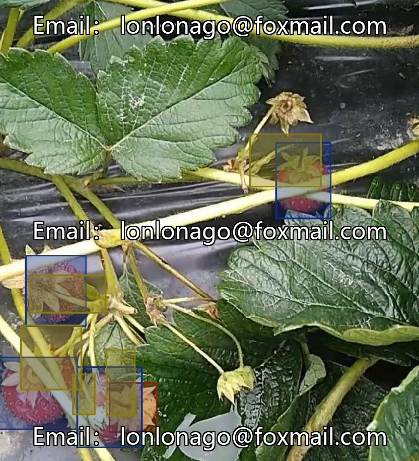
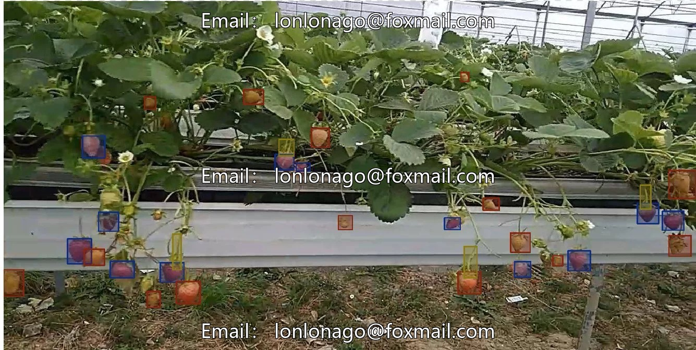
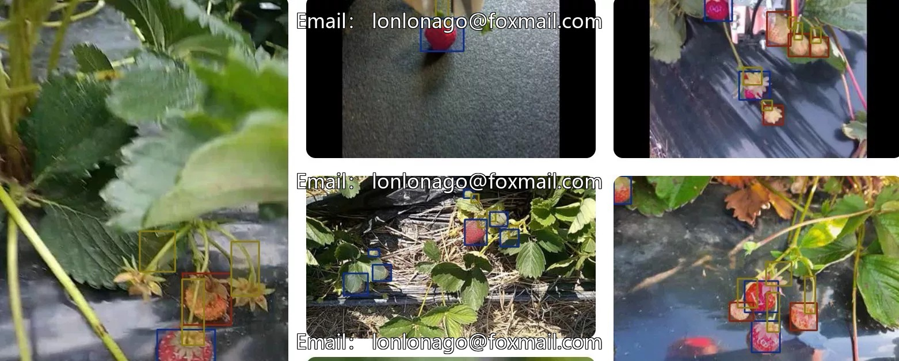
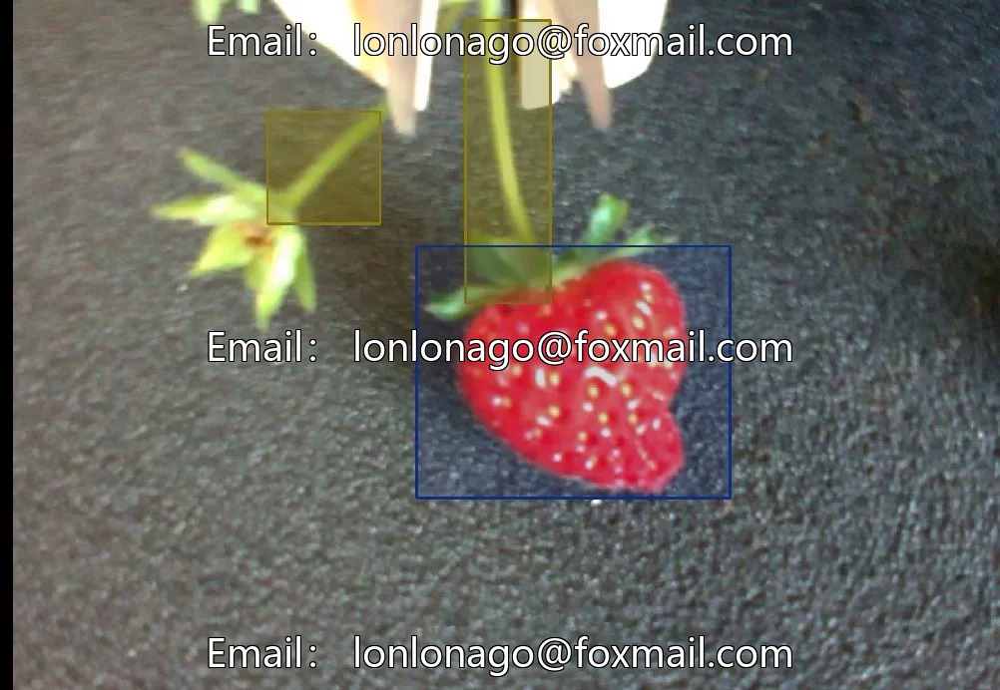
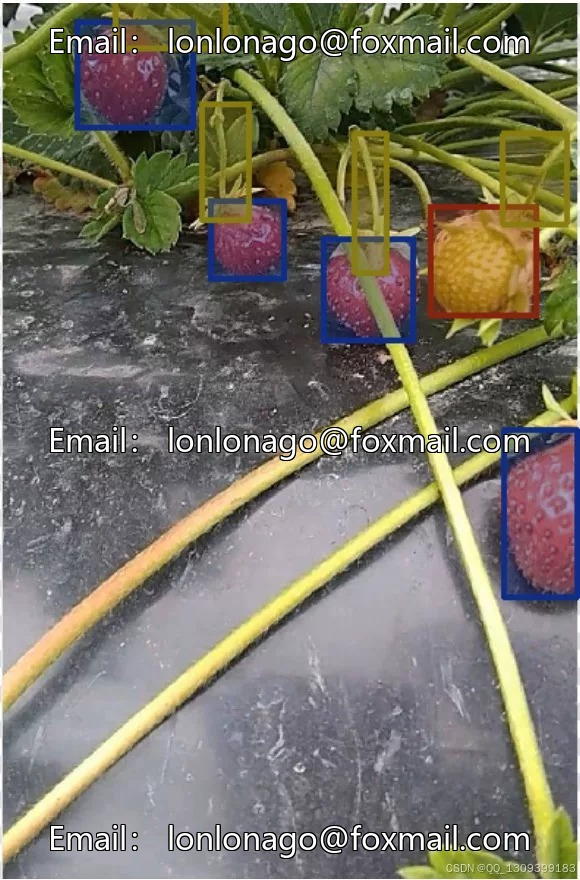

# Strawberry maturity recognition dataset

## Body

Strawberry Maturity Recognition Dataset
Strawberry Maturity Recognition Dataset for Smart Agriculture - Strawberry Maturity Identification, Strawberry Root and Stem Identification, Unripe Strawberry Dataset for Crop Maturity Recognition AI Image Recognition 10219 Issue

Information Category	Specific Content
Dataset Type	Target detection dataset, focusing on the detection and labeling of strawberry-related targets, serving specific technical needs in a particular field.
Labeling Categories	A total of 3 core labeling categories, namely ripe strawberries (ripe), strawberry peduncles (peduncle), and unripe strawberries (unripe).
Data Quantity	1. Total number of images: 813, including 11 unlabeled images (accounting for 1% of the total image count).2. Total number of labeled objects: 4568.3. Data splitting: divided into a training set (654 images) and a validation set (159 images).

Data Format: All labeled images are marked with bounding box format, which precisely defines the position of various categories of objects in the image for the training and validation of target detection models.
Application Scenarios: 1. Target detection technology research and development in the agricultural field, supporting the development of visual systems for automated equipment related to strawberries. 2. Training and validating target detection models to enhance the recognition accuracy of different growth states and fruit stalks of strawberries. 3. Providing data support for strawberry-related automated operations in agricultural production (such as harvesting and sorting), aiding the development of intelligent agriculture.

Summary: A complete restatement of the content.
The Strawberry Dataset for Object Detection is a dataset specifically designed for object detection tasks, with its application scenarios mainly concentrated in the agricultural industry. It can provide important data support for the research and development of target detection technology related to strawberries in the agricultural field, helping to solve practical needs in agricultural production and promoting the process of intelligent agriculture.

From the perspective of data scale and composition, this dataset consists of 813 images, with a total of 4568 labeled objects across three distinct categories: ripe strawberries (ripe), strawberry peduncles (peduncle), and unripe strawberries (unripe).
Among the 813 images, 11 are unlabeled, accounting for 1% of the total number of images.
To meet the needs of training and validation for target detection models, the dataset has been appropriately divided into two parts: the training set and the validation set. The training set comprises 654 images, while the validation set includes 159 images. This division method effectively ensures the validity of the data during model training and the accuracy of validation, thereby enhancing the training efficacy of the model.

# Dataset # Strawberry Maturity Identification # Strawberry Maturity Dataset #YOLO #Computer Vision

## Images

## Payment

Here is a pay link on Stripe ( https://buy.stripe.com/3cs8yP7sY87d0vu9AB ). Please contact me lonlonago@foxmail.com after funding $89, and I will send you a complete data files , thank you!

